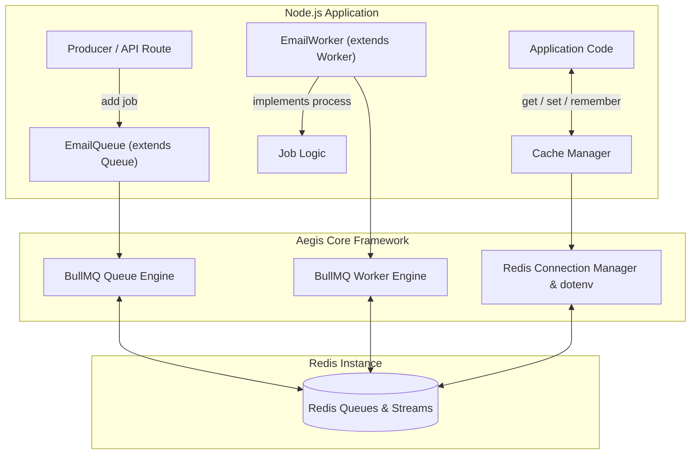

<div align="center">

# 🛡️ Aegis

**Effortless, type-safe queues, workers, and caching for Node.js.**  
_Powered by [BullMQ](https://bullmq.io/) and Redis under the hood. Does the heavy lifting for you._

[](https://www.typescriptlang.org/)
[](https://bullmq.io/)
[](https://nodejs.org/)
[](LICENSE)

</div>

---

## 📖 Table of Contents

- [Overview](#-overview)
- [Key Features](#-key-features)
- [Architecture](#-architecture)
- [Installation](#-installation)
- [Environment Configuration](#-environment-configuration)
- [Quick Start](#-quick-start)
- [Core Concepts & API](#-core-concepts--api)
  - [1. Defining & Using Queues](#1-defining--using-queues)
  - [2. Defining & Running Workers](#2-defining--running-workers)
  - [3. Redis Caching](#3-redis-caching)
  - [4. Graceful Shutdown](#4-graceful-shutdown)
- [Advanced Job & Worker Options](#-advanced-job--worker-options)
- [Best Practices](#-best-practices)
- [Contributing & License](#-contributing--license)

---

## 🌟 Overview

**Aegis** is an opinionated, TypeScript-only background processing and caching library for Node.js.

Setting up BullMQ directly often requires repetitive boilerplate: configuring Redis connections, synchronizing worker listeners, writing lifecycle handlers, wire-framing job options, and setting up standalone Redis clients for caching.

Aegis removes all that friction with an intuitive **Abstract Class** architecture:

1. Extend `Queue<TData, TResult>` to define your queue contract.
2. Extend `Worker<TData, TResult>` to define your job processor.
3. Call `new Queue()` and `new Worker()` — Aegis handles the rest.

---

## ✨ Key Features

- 🛡️ **TypeScript-First & End-to-End Type Safety:** Define your payload and return types once; get full auto-completion across queue dispatchers, jobs, and worker processors.
- 🧱 **Object-Oriented Abstract Classes:** Extend `Queue` and `Worker` to encapsulate queue configuration and processing logic cleanly.
- ⚡ **Zero-Boilerplate BullMQ Integration:** Leverages the battle-tested performance of BullMQ without the boilerplate connection or event listener setup.
- 🔑 **Built-in Redis Caching:** Built-in `Cache` manager utilizing the same Redis infrastructure for lightning-fast key-value caching with TTL and cache-aside helpers.
- 🔌 **Automatic `dotenv` Loading:** Automatically loads `.env` variables (`REDIS_HOST`, `REDIS_PORT`, `REDIS_PASSWORD`, etc.) without manual configuration.
- 🔄 **Lifecycle Hooks:** First-class hooks (`onCompleted`, `onFailed`, `onError`, `onActive`) directly inside your worker classes.
- 🛑 **Graceful Shutdown Support:** Easily coordinate graceful shutdowns on `SIGTERM` / `SIGINT` to allow in-flight jobs to complete cleanly.

---

## 🏗️ Architecture



---

## 📦 Installation

Aegis bundles `bullmq`, `ioredis`, and `dotenv` out of the box — no separate drivers needed:

```bash
# npm
npm install aegis

# pnpm
pnpm add aegis

# yarn
yarn add aegis
```

> [!NOTE]
> Aegis requires **Node.js 18+** and a running **Redis 6+** instance.

---

## ⚙️ Environment Configuration

Aegis includes built-in `dotenv` support and automatically inspects your environment variables for Redis connection settings. Create a `.env` file in the root of your project:

```env
# Redis Host & Port (defaults to localhost:6379)
REDIS_HOST=localhost
REDIS_PORT=6379

# Optional Authentication & Database
REDIS_PASSWORD=your_redis_password
REDIS_DB=0

# Alternatively, provide a full Redis connection URL:
# REDIS_URL=redis://:your_password@localhost:6379/0
```

> [!TIP]
> You can also override connection options programmatically when instantiating any Queue, Worker, or Cache instance if you manage multiple Redis clusters or databases.

---

## 🚀 Quick Start

Here is a complete, minimal example showing how to create a queue, dispatch jobs, and process them with a worker.

### 1. Define the Queue (`email.queue.ts`)

```typescript
import { Queue } from 'aegis';

// 1. Define the strongly typed payload
export interface SendEmailPayload {
  to: string;
  subject: string;
  body: string;
}

// 2. Extend the abstract Queue class
export class EmailQueue extends Queue<SendEmailPayload> {
  constructor() {
    super('email', {
      defaultJobOptions: {
        attempts: 3,
        backoff: {
          type: 'exponential',
          delay: 2000,
        },
        removeOnComplete: 1000,
        removeOnFail: 5000,
      },
    });
  }
}

// 3. Register / export the queue instance
export const emailQueue = new EmailQueue();
```

### 2. Define the Worker (`email.worker.ts`)

```typescript
import { Worker, Job } from 'aegis';
import { SendEmailPayload } from './email.queue';

export interface EmailJobResult {
  messageId: string;
  deliveredAt: string;
}

// 1. Extend the abstract Worker class
export class EmailWorker extends Worker<SendEmailPayload, EmailJobResult> {
  constructor() {
    super('email', {
      concurrency: 5, // Process up to 5 emails in parallel
    });
  }

  // 2. Implement the required process method
  async process(job: Job<SendEmailPayload>): Promise<EmailJobResult> {
    const { to, subject } = job.data;
    console.log(`[Job ${job.id}] Sending email to ${to} (${subject})...`);

    // Simulate sending email
    await new Promise((resolve) => setTimeout(resolve, 500));

    return {
      messageId: `msg_${Date.now()}`,
      deliveredAt: new Date().toISOString(),
    };
  }

  // 3. Optional lifecycle hooks
  override onCompleted(job: Job<SendEmailPayload>, result: EmailJobResult) {
    console.log(`[Job ${job.id}] Completed! Message ID: ${result.messageId}`);
  }

  override onFailed(job: Job<SendEmailPayload> | undefined, error: Error) {
    console.error(`[Job ${job?.id}] Failed with error:`, error.message);
  }
}

// 4. Start the worker
new EmailWorker();
```

### 3. Dispatch a Job (`server.ts`)

```typescript
import { emailQueue } from './email.queue';

async function main() {
  const job = await emailQueue.add('send-welcome', {
    to: 'alex@example.com',
    subject: 'Welcome to Aegis!',
    body: 'Your queue setup is complete.',
  });

  console.log(`Enqueued job ${job.id}`);
}

main();
```

---

## 📚 Core Concepts & API

### 1. Defining & Using Queues

The `Queue<TData, TResult>` class wraps BullMQ's queue while maintaining strict type safety.

#### Adding Jobs

```typescript
// Single job
await emailQueue.add('send-notification', payload);

// Job with custom options
await emailQueue.add('send-reminder', payload, {
  delay: 60000, // Delay execution by 60 seconds
  priority: 1, // Higher priority
  jobId: 'reminder-user-42', // Deduplication key
});

// Bulk jobs in a single Redis transaction
await emailQueue.addBulk([
  { name: 'batch-1', data: payloadA },
  { name: 'batch-2', data: payloadB },
]);
```

#### Queue Control Operations

```typescript
// Pause and resume queue processing
await emailQueue.pause();
await emailQueue.resume();

// Inspect job counts
const counts = await emailQueue.getJobCounts(
  'waiting',
  'active',
  'completed',
  'failed',
);
console.log(counts); // { waiting: 0, active: 1, completed: 120, failed: 2 }

// Empty or clean obsolete jobs
await emailQueue.clean(3600 * 1000, 100, 'completed'); // Clean jobs older than 1 hour
```

---

### 2. Defining & Running Workers

The `Worker<TData, TResult>` abstract class handles the lifecycle and event synchronization of worker threads.

#### Implementing Process Logic & Progress

```typescript
export class DataImportWorker extends Worker<
  { fileUrl: string },
  { rows: number }
> {
  constructor() {
    super('data-import', { concurrency: 2 });
  }

  async process(job: Job<{ fileUrl: string }>) {
    await job.updateProgress(10); // 10%

    // Process stream...
    await job.updateProgress(50); // 50%

    // Finish
    await job.updateProgress(100);
    return { rows: 15000 };
  }
}
```

#### Lifecycle Hooks

Override any of the following methods directly inside your worker subclass:

| Method                      | Triggered When                                             |
| --------------------------- | ---------------------------------------------------------- |
| `process(job)` _(Required)_ | The main execution logic for incoming jobs.                |
| `onActive(job)`             | A job has been picked up from the queue and started.       |
| `onCompleted(job, result)`  | A job has finished successfully with its return value.     |
| `onFailed(job, error)`      | A job has thrown an error or exhausted all retry attempts. |
| `onProgress(job, progress)` | `job.updateProgress()` was invoked.                        |
| `onError(error)`            | An internal worker or Redis connection error occurred.     |

---

### 3. Redis Caching

Aegis includes a lightweight, type-safe caching layer directly connected to your Redis instance, eliminating the need for a secondary caching library.

```typescript
import { Cache } from 'aegis';

interface UserProfile {
  id: string;
  name: string;
  role: string;
}

// 1. Set a value with TTL (in seconds)
await Cache.set(
  'user:42',
  { id: '42', name: 'Alice', role: 'admin' },
  { ttlSeconds: 300 },
);

// 2. Retrieve a typed value
const user = await Cache.get<UserProfile>('user:42');

// 3. Delete / Invalidate a key
await Cache.del('user:42');

// 4. Cache-Aside pattern with `remember()`
// Fetches from cache if present; otherwise runs the callback, caches the result, and returns it
const profile = await Cache.remember<UserProfile>(
  'user:profile:42',
  600, // 10 minutes TTL
  async () => {
    return await database.findUserById('42');
  },
);
```

---

### 4. Graceful Shutdown

In containerized environments (Kubernetes, Docker, ECS), graceful shutdowns prevent jobs from being interrupted midway. Aegis makes shutdown seamless:

```typescript
import { emailQueue } from './email.queue';
import { emailWorker } from './email.worker';
import { Cache } from 'aegis';

async function shutdown() {
  console.log('Shutting down gracefully...');

  // 1. Wait for in-flight jobs to finish processing
  await emailWorker.close();

  // 2. Close queue connections
  await emailQueue.close();

  // 3. Disconnect cache
  await Cache.disconnect();

  process.exit(0);
}

process.on('SIGTERM', shutdown);
process.on('SIGINT', shutdown);
```

---

## ⚙️ Advanced Job & Worker Options

### Retry Strategies & Exponential Backoff

Configure robust retry strategies directly inside your `Queue` constructor or per-job:

```typescript
export class BillingQueue extends Queue<InvoicePayload> {
  constructor() {
    super('billing', {
      defaultJobOptions: {
        attempts: 5,
        backoff: {
          type: 'exponential',
          delay: 5000, // 5s, 10s, 20s, 40s...
        },
      },
    });
  }
}
```

### Rate Limiting & Concurrency

Prevent overloading downstream third-party APIs by setting rate limits on your worker:

```typescript
export class WebhookWorker extends Worker<WebhookPayload> {
  constructor() {
    super('webhooks', {
      concurrency: 10,
      limiter: {
        max: 50, // Max 50 jobs
        duration: 1000, // Per 1,000 ms (1 second)
      },
    });
  }

  async process(job: Job<WebhookPayload>) {
    await sendWebhook(job.data);
  }
}
```

---

## 💡 Best Practices

1. **Separate Queues & Workers in Dedicated Processes:**  
   In production, instantiate `Queue` producers in your HTTP web servers / API routes and run `Worker` instances in dedicated background worker services to scale independently.
2. **Always Type Payloads Explicitly:**  
   Avoid using `any` or `Record<string, unknown>`. Defining clear TypeScript interfaces for `TData` and `TResult` guarantees type safety across your team.
3. **Use Idempotent Job IDs:**  
   When enqueuing payment or external notification jobs, pass a unique `jobId` (e.g., `invoice_pay_${invoiceId}`) to prevent accidental duplicate execution.
4. **Leverage Cache Aside:**  
   Use `Cache.remember()` inside your workers or API endpoints to guard expensive database lookups and prevent cache thundering herds.

---

## 📄 License

This project is licensed under the [MIT License](LICENSE).
